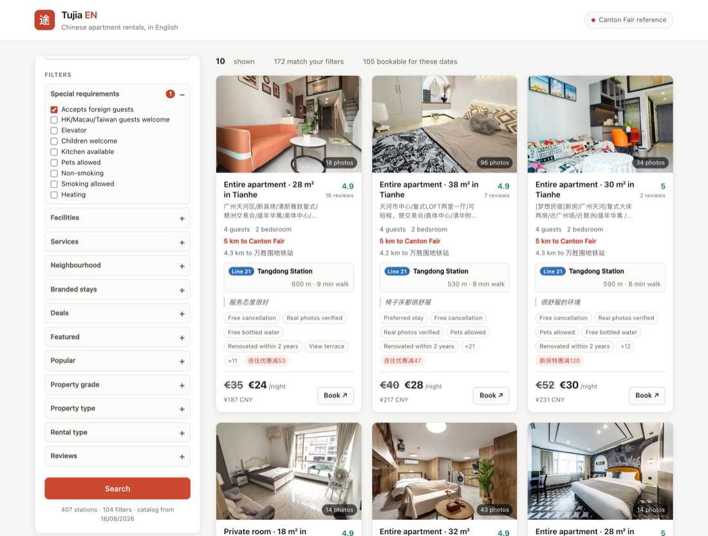

# Tujia Proxy EN

English-language proxy and web UI for [Tujia](https://m.tujia.com) (途家) apartment rentals,
specialised for finding Canton Fair accommodation in Guangzhou.

Tujia has no public API and no English interface. This reverse-engineers its mobile web
endpoints, translates the results, and serves a searchable English front end.



## Quick start

```bash
bun install
cp cookies.example.txt cookies.txt   # then paste your own session into it
bun run dev
```

Then open **http://localhost:3000**.

Tujia's endpoints need a logged-in browser session. Open m.tujia.com, log in, and copy
your cookies from DevTools (Application → Cookies) into `cookies.txt`. That file is
gitignored — it is a real session, so keep it out of commits. `GET /api` tells you
whether a session was loaded.

## What you get

- **406 metro stations across 21 lines**, searchable in English (Pazhou, Wanshengwei, Tiyuxilu…)
- **104 filters** translated — accepts foreign guests, near metro, free parking, kitchen,
  instant confirmation, rating floors, and the rest of Tujia's taxonomy
- **Filter by a whole metro line** ("everything along Line 8"), not just a single station —
  using Tujia's own line filter, so it paginates properly. Branches are listed separately
  (`Line 3 · Tiyuxilu ↔ Jichangbei`) because they really are different corridors
- **Nearest metro station and line** on every listing, with walking distance and time —
  computed from the unit's own coordinates against all 406 stations, so it's the station
  you'd actually walk to, not the one you searched for
- **Real distance to the Canton Fair complex** for every listing, computed from the unit's
  own coordinates rather than guessed from its address
- Prices in EUR alongside the original CNY, with pre-discount rates where Tujia reports them

## Endpoints

| Method | Path | Purpose |
|---|---|---|
| `GET`  | `/` | the English web UI |
| `GET`  | `/api` | service info |
| `GET`  | `/api/v1/cities` | supported cities |
| `GET`  | `/api/v1/filters` | the English filter catalog that drives the UI |
| `POST` | `/api/v1/search` | search listings |
| `GET`  | `/api/v1/hotel/:id` | **501** — Tujia's detail endpoint has not been reverse-engineered yet |

### Search example

```bash
curl -X POST http://localhost:3000/api/v1/search \
  -H 'content-type: application/json' \
  -d '{
    "checkIn": "2026-10-10",
    "checkOut": "2026-11-05",
    "guestCount": 2,
    "priceMax": 300,
    "sort": "2",
    "amenities": ["237", "2301"],
    "maxDistanceToFairKm": 6
  }'
```

`amenities` takes filter ids from `/api/v1/filters` (`237` = accepts foreign guests,
`2301` = near metro). `sort` takes a sort id (`1` most popular, `2` price ascending).

To search a whole metro line, send `metroLineId` with a `filterValue` from
`/api/v1/filters` → `metroLines[]` (e.g. `"7_268250"` for Line 8). Send at most one, and
note that `metroStationId` takes precedence — Tujia honours a single geo condition.

### Pagination

Send `pageIndex` and `pageSize`; the response carries a cursor:

```jsonc
{
  "total": 10,
  "totalAvailable": 2314,
  "nextPageIndex": 4,   // echo this back for the next page — NOT pageIndex + 1
  "hasMore": true
}
```

Echo `nextPageIndex` rather than incrementing yourself: with `maxDistanceToFairKm` the
server walks several upstream pages per response, so the cursor can jump (`0 → 4 → 9`).
`hasMore` is false only once Tujia runs out of listings. Tujia's ranking drifts between
requests, so dedupe by `id` when appending — the web UI does.

## Keeping it working

Sessions expire. When search starts returning `401 Tujia session expired`, refresh
`cookies.txt` from DevTools — the file is re-read automatically, **no restart needed**.

Accepted formats: one `name=value` per line (`#` for comments), or a single pasted
`Cookie: a=1; b=2` header line. Use `TUJIA_COOKIES_FILE` to point elsewhere.

Reference requests for both live endpoints are kept in `requests.http`.

> ⚠️ `requests.http` and the `test-*.sh` scripts still contain a captured session inline.
> They aren't used by the app, but scrub them before sharing the repo.

To refresh the filter catalog after Tujia changes its taxonomy:

```bash
bun run catalog
```

## Other commands

```bash
bun run mock             # run the mapper over a captured listing — catches field drift
bun run scraper          # Playwright fallback that scrapes via a real browser
bun run scraper:headed   # visible browser, needed for the one-time login
npx tsc --noEmit         # typecheck
```

See `SCRAPER.md` for the browser-based scraper, and `CLAUDE.md` for the architecture
and the reverse-engineering notes.

## Caveats

- Listing **titles stay Chinese** — Tujia's `unitName` is keyword-spam and the API exposes
  no English title. The UI synthesises a headline from the structured facts
  (`"Entire apartment · 67 m² in Liwan"`) and shows the original underneath.
- CNY→EUR uses a **fixed rate** (`CONFIG.CNY_TO_EUR`), so prices are indicative.
- Booking still happens on Tujia, in Chinese. The **Book ↗** link opens the listing there.
- Only Guangzhou (city `45`) is exercised. Other city ids are exposed but untested, and the
  geo defaults are Guangzhou-specific.
